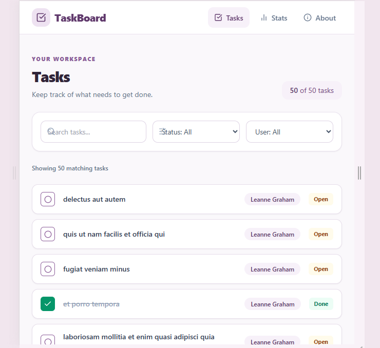
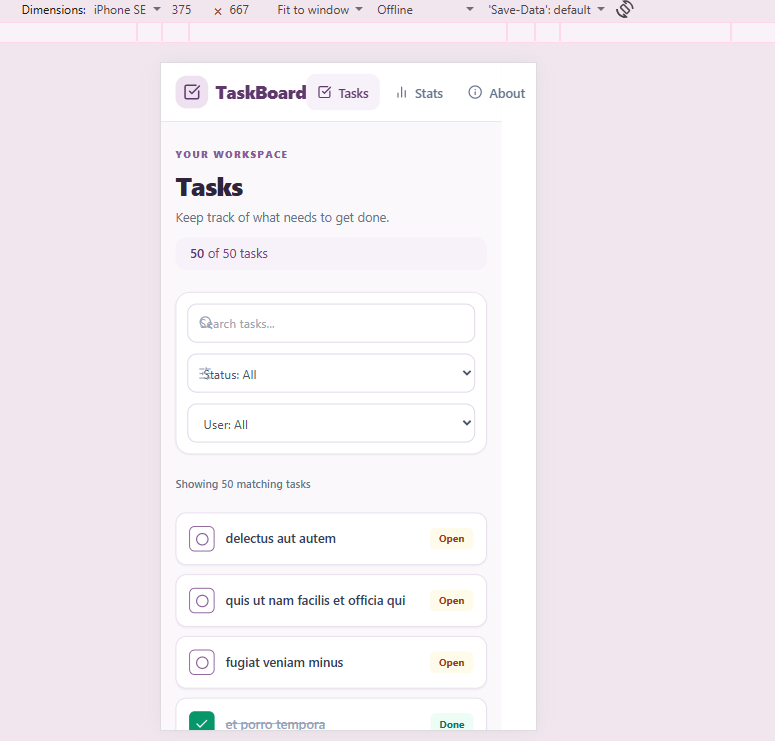
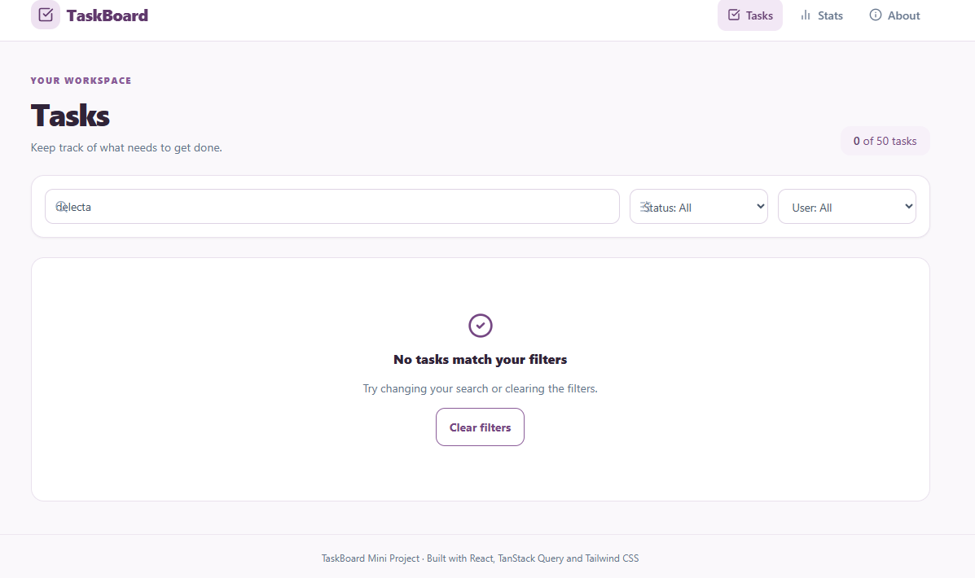
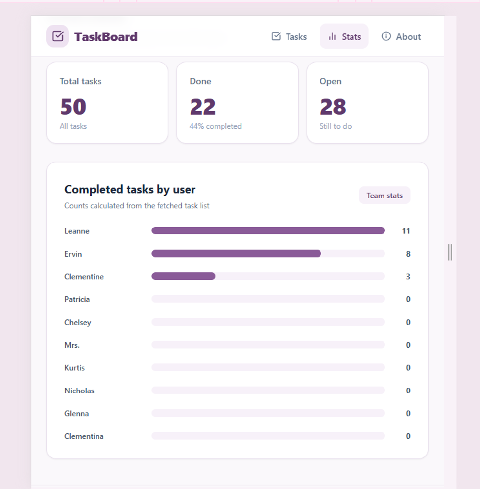

# TaskBoard — Mini Project 1

A responsive, multi-page task-tracking application built with React, Vite, React Router, TanStack Query and Tailwind CSS. The interface follows the supplied TaskBoard rough mockup and uses JSONPlaceholder's todo-shaped data.

## Features

- Fetches up to 200 tasks and user information from the JSONPlaceholder public API.
- Search tasks by title and filter by completion status or assigned user.
- Dynamic task details route reads the `:id` URL parameter and fetches the matching task.
- Mark a task done or reopen it. This is a local demo interaction; JSONPlaceholder does not permanently save changes.
- Stats overview showing total, completed and open tasks, plus completed tasks by user.
- Loading, error, empty-filter and success/list states.
- Responsive Tailwind CSS layout for mobile and desktop.
- Reusable components and centralized API functions.

## Routes

| Route | Description |
| --- | --- |
| `/` | Task list, search and filters |
| `/tasks/:id` | Dynamic task details page (example: `/tasks/2`) |
| `/stats` | Task totals and completed tasks by user |
| `/about` | Project and technology information |

## Public API

**JSONPlaceholder** — https://jsonplaceholder.typicode.com

- `GET /todos?_limit=200` — task list
- `GET /todos/:id` — one task by ID (used by the dynamic route)
- `GET /users` — user names for assignment labels and statistics

The single-task endpoint was selected because the API supports retrieving a todo by ID. API data is read-only for this project. Mark-done interactions update TanStack Query's in-memory cache for the current session only.

## TanStack Query and UI-state handling

- `QueryClientProvider` is configured in `src/main.jsx`.
- The task list uses the `['tasks']` query key.
- Task details use `['task', id]`, with the ID taken from `useParams()`.
- User information uses the `['users']` query key.
- Queries expose pending, error and success states. The task list also displays an empty state when filters return no matches.
- A mutation updates the relevant cached task data when the user marks a task done or reopens it.

## Technology stack

- React 18
- Vite
- React Router DOM 6
- TanStack Query 5
- Tailwind CSS 3
- Lucide React icons
- JSONPlaceholder REST API

## Getting started

### Prerequisites

- Node.js 18 or later (Node.js 20 LTS recommended)
- npm
- Internet connection to access JSONPlaceholder

### Installation

```bash
# 1. Move into the project folder
cd taskboard

# 2. Install dependencies
npm install

# 3. Start the development server
npm run dev
```

Open the local URL printed by Vite (normally http://localhost:5173).

### Production build

```bash
npm run build
npm run preview
```

The production-ready files are generated in the `dist/` directory.

## Project structure

```text
taskboard/
├── index.html
├── package.json
├── vite.config.js
├── tailwind.config.js
├── postcss.config.js
├── README.md
└── src/
    ├── main.jsx
    ├── App.jsx
    ├── index.css
    ├── components/
    │   ├── Layout.jsx
    │   ├── TaskCard.jsx
    │   └── States.jsx
    ├── lib/
    │   └── api.js
    └── pages/
        ├── Tasks.jsx
        ├── TaskDetails.jsx
        ├── Stats.jsx
        └── About.jsx
```

## Screenshots

### Task list



### Mobile layout



### Empty search results



### Statistics



## Notes for review

- Test the dynamic route with `/tasks/2` and another valid todo ID.
- Test the empty state by entering a search term that matches no task.
- Test the loading state on initial data fetch and the error state by temporarily disconnecting the network or blocking the API request.
- Test the responsive layout by narrowing the browser window or using mobile device emulation.
- Task completion is intentionally local because JSONPlaceholder is a fake/demo API and does not persist server-side changes.

## Live demo

Add your deployed URL here after publishing (for example, with Vercel or Netlify).

## License

This project is created for educational purposes as an independent learning mini project.
